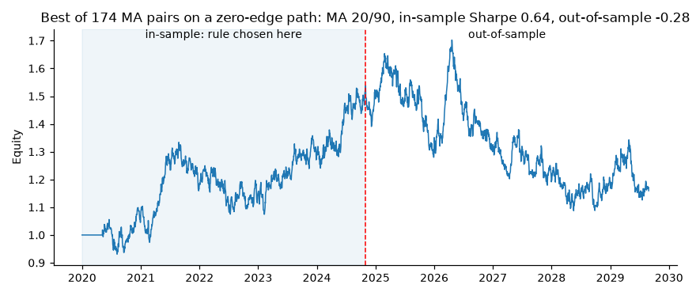

# qbrp: a small, honest backtesting engine

[](https://github.com/muringi21/quant-backtest-risk-platform/actions/workflows/ci.yml)

`qbrp` is a Python library and command-line tool for backtesting simple trading
rules on a single price series. It is deliberately small. What it tries to do
well is make every number traceable: execution timing is explicit, costs are
charged on turnover, inputs are validated, and the documentation says what
the results cannot tell you.

It comes with a set of reproducible synthetic experiments, including a worked
example of how a naive parameter search produces a convincing backtest for a
strategy with no edge at all. **[Read the analysis](docs/analysis.md).**

> The repository name is historical. This project is a backtesting engine with
> performance and risk metrics. It does not include a web API, database,
> container setup, portfolio optimiser or risk model.

## What it does

- **Prices:** a seeded synthetic generator (random walk with drift, optionally
  with a hidden trend of known strength), or your own CSV of close prices.
- **Strategies:** moving-average crossover (long-short or long-only),
  time-series momentum, and buy-and-hold as the benchmark.
- **Engine:** vectorised, single asset, positions in `[-1, 1]`, configurable
  execution lag between signal and trade, and a proportional fee per unit of
  turnover.
- **Metrics:** total return, CAGR, volatility, Sharpe ratio with its standard
  error, maximum drawdown, turnover, exposure and costs.
- **Experiments:** strategy comparison across 200 simulated paths, fee and lag
  sensitivity, and an in-sample vs out-of-sample overfitting study. Every
  result is regenerated by one command.

## Install

Requires Python 3.11+.

```bash
git clone https://github.com/muringi21/quant-backtest-risk-platform.git
cd quant-backtest-risk-platform
python -m venv .venv && source .venv/bin/activate
pip install -e ".[dev]"     # or ".[plots]" for figures only, or "." for the core
pytest                      # full suite runs in a few seconds
```

## Command-line usage

Run the default backtest (MA 20/50 long-short on three years of synthetic data):

```console
$ qbrp backtest
MA 20/50 long-short on synthetic (seed 7)
  Bars: 756   Fee: 1 bp/turnover   Execution lag: 1 bar(s)
  Total return:     -10.85%
  CAGR:             -3.76%
  Volatility (ann): 14.47%
  Sharpe (rf=0):    -0.19  (+/- 0.58 s.e.)
  Max drawdown:     -31.13%
  Position changes: 17   Turnover/yr: 11.0x   Avg |exposure|: 93%
  Costs (sum):      0.33% of equity, summed over bars
```

Seed 7 happens to be an unlucky path: buy-and-hold on the same prices loses 42%
(`qbrp backtest --strategy buy-hold`), even though the generator's drift is
positive. Notice the standard error of ±0.58 on three years of data: on its own
this backtest cannot distinguish a good rule from a bad one.

More examples:

```bash
# Long-only MA with higher costs and same-close execution
qbrp backtest --strategy ma-long --fast 10 --slow 100 --fee-bps 10 --lag 0

# Ten years of prices with a weak hidden trend, 126-day momentum
qbrp backtest --strategy momentum --lookback 126 --bars 2520 --trend-share 0.02 --seed 3

# Your own data: any CSV with a price column (and optionally a date column)
qbrp backtest --csv examples/synthetic_prices.csv --column close --fast 10 --slow 40

# Machine-readable output and a per-bar audit trail
qbrp backtest --json --equity-out equity.csv

# Regenerate every experiment, table and figure in docs/results (~45 s)
qbrp experiment all --out docs/results
```

`qbrp --help` and `qbrp backtest --help` list every option. `python -m qbrp` works
too. Invalid input produces a one-line message and exit code 2:

```console
$ qbrp backtest --fast 50 --slow 20
Error: fast window (50) must be shorter than slow window (20)
```

`--equity-out` writes the target position, held position, gross return, cost,
net return and equity for every bar, so any single number can be checked by
hand in a spreadsheet.

## Library usage

```python
from qbrp.data import make_sample_prices
from qbrp.engine import run_backtest
from qbrp.strategies import MACrossConfig, buy_and_hold, ma_crossover

close = make_sample_prices(n=2520, seed=1, trend_share=0.02)["close"]

strategy = run_backtest(close, ma_crossover(close, MACrossConfig(20, 50)), fee_bps=1.0)
benchmark = run_backtest(close, buy_and_hold(close), fee_bps=1.0)

print(f"MA 20/50:     Sharpe {strategy.sharpe:.2f} +/- {strategy.sharpe_se:.2f}")
print(f"Buy and hold: Sharpe {benchmark.sharpe:.2f} +/- {benchmark.sharpe_se:.2f}")
print(strategy.summary())        # dict of every scalar metric
strategy.equity                  # pandas Series, same index as the prices
```

A strategy is any function returning a `pandas.Series` of target exposures in
`[-1, 1]` on the same index as the prices. See
[`examples/library_usage.py`](examples/library_usage.py).

## How the backtest is computed

For each bar `t`, with simple asset return `r[t]` and execution lag `L`:

```
held[t] = position[t - L]                      # signal at close t, traded L bars later
net[t]  = held[t-1] * r[t]  -  fee_bps/1e4 * |held[t] - held[t-1]|
equity  = cumprod(1 + net)
```

The return paid at bar `t` depends only on positions decided at or before
`t - 1 - L`, so a strategy that looks backwards cannot see the return it is
paid on. A test rewrites every price after a cut-off and checks that no earlier
strategy return changes.

The default lag is 1 (trade at the next close). Lag 0, the v0.1 behaviour,
trades at the same close that produced the signal, which is optimistic.

**Main simplifications:** fills at the close, one proportional cost covering
commission, spread and slippage, free unlimited shorting, no financing or
borrow costs, no leverage, zero risk-free rate, and a single asset. All
of them are explained in [docs/methodology.md](docs/methodology.md).

## Results from the synthetic experiments

Full tables: [docs/results/report.md](docs/results/report.md). Interpretation:
[docs/analysis.md](docs/analysis.md). In brief, over 200 ten-year paths:

- **No edge, no outperformance.** On a random walk, MA and momentum rules have
  a mean Sharpe of 0.04-0.40, against 0.56 for buy-and-hold, and beat it on
  only 10-20% of paths.
- **A real but weak edge is hard to confirm.** With a hidden trend planted, MA
  20/50 long-short averages a Sharpe of 0.80 against buy-and-hold's 0.58, yet
  still trails buy-and-hold on 40% of paths.
- **Costs scale with turnover.** The fast MA 5/20 rule (turnover about 28x a year) loses
  its advantage at about 10 bp per trade and loses money at 50 bp; MA 20/50 is
  far more robust. The engine's results match a hand calculation of
  turnover × fee ÷ volatility.
- **Choosing the best of 174 parameter pairs is the trap.** With no edge, the
  in-sample winner averages a Sharpe of 0.67 (above 1.0 on 18% of paths) and
  0.01 out of sample.



These are statements about simulated markets whose properties we chose. They
test whether the method behaves correctly. They are not evidence that any
strategy works on real assets.

## Project layout

```
src/qbrp/
  data.py          synthetic generator and CSV loader
  strategies.py    MA crossover, momentum, buy-and-hold
  engine.py        timing model, costs, BacktestResult
  metrics.py       return, CAGR, volatility, Sharpe (+ s.e.), drawdown, max-Sharpe bound
  validation.py    shared input checks; errors.py defines BacktestInputError
  experiments.py   the three synthetic studies
  report.py        writes CSVs + report.md; plots.py draws figures (optional)
  cli.py           qbrp backtest / qbrp experiment
tests/             unit, property and regression tests for every module
docs/              methodology, analysis and generated results
examples/          library example and a sample CSV (synthetic prices)
```

## Testing

```bash
pytest                       # all tests
pytest --cov=qbrp            # with coverage
ruff check .                 # lint (also run in CI)
```

The suite includes hand-computed backtests for lags 0 and 1, equivalence with
the v0.1 formula, a no-look-ahead check, linear cost scaling, metric values
checked against manual formulas, a simulation check that the Sharpe standard
error is calibrated, every validation error path, CLI behaviour, and a check
that the experiment report is byte-for-byte reproducible.

## Limitations

- One asset, daily close prices, no intraday execution model.
- Costs are a single linear rate; real costs depend on size, liquidity and
  volatility.
- Shorting and rebalancing are frictionless apart from that rate.
- The Sharpe standard error assumes i.i.d. normal returns and understates real
  uncertainty.
- Synthetic prices have Gaussian returns and constant volatility, unlike real
  markets with fat tails and volatility clustering.
- No walk-forward optimisation, portfolio construction or position sizing.

## Changelog

See [CHANGELOG.md](CHANGELOG.md). v0.2 changes some default numbers compared
with v0.1, mainly because the default execution lag is now 1 bar.

## License

No license file has been added yet, so default copyright applies.
