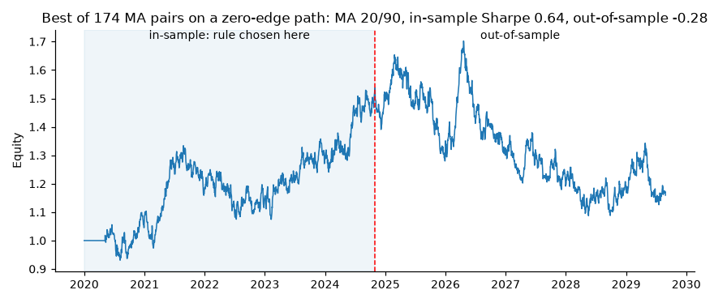
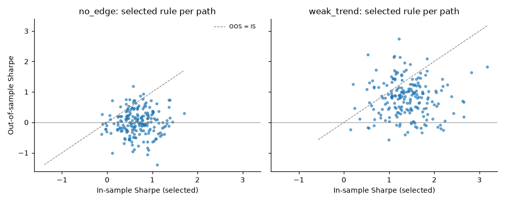

# What a simple backtester can and cannot tell you

A worked analysis using only synthetic data, where the truth is known.

All numbers here come from [`docs/results/report.md`](results/report.md),
which is generated by:

```bash
qbrp experiment all --out docs/results     # about 45 seconds; 200 paths per study
```

Each study uses 200 simulated price paths of 2,520 trading days (about ten
years), with seeds 0-199. Every strategy is run on the same paths, so
differences between strategies are not caused by different luck. Unless stated
otherwise the fee is 1 bp per unit of turnover and trades execute one bar after
the signal.

The point of using synthetic data is that we decide whether an edge exists.
That lets us ask a question that cannot be answered with one real price
history: **when the backtest says a rule works, how often is it right?**

---

## 1. With no edge, timing rules do not beat buy-and-hold

In the `random_walk` regime, prices follow a random walk with about 7.5% a year
of drift and 16% volatility. Past prices contain no information about future
returns, so no moving-average or momentum rule can have a genuine edge.

| Strategy | Mean Sharpe | 5th-95th percentile | Beats buy-and-hold on the same path |
|---|---:|---:|---:|
| Buy and hold | 0.56 | -0.02 to 1.09 | - |
| MA 20/50 long-short | 0.07 | -0.44 to 0.61 | 10% |
| MA 20/50 long-only | 0.40 | -0.19 to 0.94 | 20% |
| Momentum 126d long-short | 0.15 | -0.41 to 0.80 | 14% |

This is what theory predicts. A long-short rule spends part of its time short
an asset that drifts upwards, which gives up return. A long-only rule spends
part of its time in cash, which gives up return. Neither gets anything back,
because there is no trend to catch.

The percentile band matters as much as the mean. Even buy-and-hold, with a true
Sharpe of about 0.56, produced a ten-year Sharpe anywhere from roughly 0 to 1.1
depending on the path. On their luckiest 5% of paths, timing rules with no edge
reached Sharpe ratios of 0.6-0.9. **A single backtest showing Sharpe 0.6 is fully consistent with
a rule that has no edge.**

## 2. With a weak real edge, trend rules win, but not reliably

The `weak_trend` regime adds a hidden, slowly changing trend that accounts for
2% of daily return variance. The lag-1 autocorrelation of returns is only about
0.02, which you would struggle to detect with a standard test, but the trend
persists for weeks, and that is what moving averages are built to follow.

| Strategy | Mean Sharpe | 5th-95th percentile | Beats buy-and-hold on the same path |
|---|---:|---:|---:|
| Buy and hold | 0.58 | -0.40 to 1.53 | - |
| MA 20/50 long-short | 0.80 | 0.13 to 1.44 | 60% |
| MA 20/50 long-only | 0.89 | 0.06 to 1.72 | 86% |
| Momentum 126d long-short | 0.74 | -0.09 to 1.50 | 55% |

Now the rules do have an edge, and they show it on average. But the long-short
moving-average rule still trailed buy-and-hold on **40% of ten-year paths**.
Real edges of this size are hard to confirm from one history: the standard error
of a ten-year Sharpe is about 0.32, larger than the gap between the strategy
(0.80) and the benchmark (0.58).

The long-only variant beats buy-and-hold most consistently because it keeps the
drift during up-trends and steps aside during down-trends, roughly halving the
average maximum drawdown (-25% against -46%).

## 3. Costs and execution delay

Section 2 shows a real edge exists. How much of it survives realistic frictions?

Mean Sharpe of **MA 5/20 long-short** (turnover about 28 times a year) in the
`weak_trend` regime:

| Fee (bp) | Lag 0 | Lag 1 | Lag 5 | Lag 20 |
|---:|---:|---:|---:|---:|
| 0 | 0.77 | 0.76 | 0.69 | 0.50 |
| 5 | 0.68 | 0.67 | 0.60 | 0.41 |
| 10 | 0.59 | 0.58 | 0.51 | 0.32 |
| 20 | 0.41 | 0.40 | 0.33 | 0.15 |
| 50 | -0.11 | -0.13 | -0.20 | -0.38 |

Mean Sharpe of **MA 20/50 long-short** (turnover about 9 times a year):

| Fee (bp) | Lag 0 | Lag 1 | Lag 5 | Lag 20 |
|---:|---:|---:|---:|---:|
| 0 | 0.81 | 0.81 | 0.74 | 0.54 |
| 10 | 0.75 | 0.75 | 0.68 | 0.48 |
| 50 | 0.51 | 0.51 | 0.44 | 0.25 |

Buy-and-hold has a mean Sharpe of 0.58 on the same paths.

**Fees scale with turnover, and the numbers can be checked by hand.** Annual
cost drag is roughly turnover times fee. For the fast rule at 10 bp that is
28 x 0.10% = 2.8% a year; divided by 16% volatility it is about 0.18 of Sharpe.
The table shows 0.76 falling to 0.58, a drop of 0.18. For the slow rule the same
sum gives 9.3 x 0.10% / 16% = 0.06, and the table shows 0.81 falling to 0.75.
When a back-of-envelope estimate and the engine agree like this, it is good
evidence that the engine is doing what the documentation says.

At about 10 bp the fast rule's advantage over buy-and-hold has gone completely,
and at 50 bp it loses money. The slow rule is far more robust to costs,
because it trades a third as often for a similar gross edge.

**Execution delay hurts slowly here, and that is a property of the market model.**
The hidden trend has persistence 0.98, a half-life of about 34 days, so trading
one day late costs almost nothing, while 20 days late costs around a third of
the edge. A faster-decaying signal would be far more sensitive to the
difference between lag 0 and lag 1. That is why v0.2 defaults to lag 1 and
makes the assumption explicit, instead of silently assuming same-close
execution.

## 4. Why a naive backtest misleads: the best of many tries

This is the most common way a backtest overstates what a strategy can do.

**The naive procedure.** Take one price history. Try every moving-average pair
on a grid (here 174 pairs: fast 5-50, slow 20-200). Keep the one with the best
Sharpe. Report that Sharpe.

**The test.** We do this on the `no_edge` regime, a random walk with zero drift.
No rule can predict returns, so every long-short rule has a true Sharpe of
about 0 (slightly negative after costs). We choose the
best pair using only the first five years, then measure that same pair on the
next five.

| Regime | Best in-sample Sharpe | Same rule, out of sample | Median rule, out of sample | Paths where best in-sample > 1 |
|---|---:|---:|---:|---:|
| `no_edge` | 0.67 | 0.01 | -0.02 | 18% |
| `weak_trend` | 1.39 | 0.79 | 0.77 | 83% |

In the no-edge world the selected rule averaged an in-sample Sharpe of 0.67,
and on almost a fifth of paths it exceeded 1.0, a figure that would look
impressive in a portfolio write-up. Out of sample it averaged 0.01. The selected
rule's out-of-sample rank among all 174 was, on average, the 51st percentile:
**the search picked a rule no better than a random choice.**

The trending world is more subtle and more realistic. There is a real edge, and
the selected rule does keep a positive out-of-sample Sharpe (0.79). But its
in-sample Sharpe overstated that by about 0.6, and it did no better out of
sample than the median rule on the grid (0.77). The grid search added a large,
misleading boost to the reported number and almost nothing to real performance.

### One path, chosen mechanically

To avoid cherry-picking, the example in the report is the path whose best
in-sample Sharpe is the **median** across the 200 paths (seed 46). On that path,
MA 20/90 was the winner, with an in-sample Sharpe of 0.64 and a smooth-looking
rise in equity. Over the following five years the same rule returned a Sharpe of
-0.28.





### How much should we have expected?

`metrics.expected_max_sharpe_under_null` estimates the best Sharpe expected from
`N` *independent* worthless strategies (Bailey & Lopez de Prado, 2014). For 174
trials on five years of daily data it gives 1.22, higher than the 0.67 we
observed. The difference is because neighbouring moving-average pairs make
nearly the same trades, so 174 correlated trials behave like about **8
independent ones** (the formula gives 0.65 for 8 trials). Counting your trials
honestly, including the ones you tried and discarded, is the first step in
judging whether a backtest result is meaningful.

## What this means for using `qbrp`

1. **Report a range, not a point.** Quote the Sharpe with its standard error
   (the CLI prints it) and, where possible, the spread across several seeds or
   sub-periods.
2. **Compare with buy-and-hold on the same data.** A timing rule that loses to
   doing nothing is not a strategy.
3. **Separate choosing from measuring.** Pick parameters on one period and judge
   them on another, and say how many variants you tried.
4. **Price in frictions before celebrating.** Look at turnover first; any rule
   trading more than about 20 times a year needs its edge checked at realistic
   costs.
5. **Treat synthetic results as tests of the method, not of the market.**
   Everything above shows how the tools behave when the truth is known. None of
   it says moving averages work on any real asset.

## Reproducing and extending

* Re-run: `qbrp experiment all --out results --seeds 200`. Outputs are
  byte-for-byte identical across runs (this is tested). The CSVs were also
  checked to be identical under Python 3.11 / pandas 2.3 / NumPy 2.2 and
  Python 3.14 / pandas 3.1 / NumPy 2.5.
* Change a study: the functions in `src/qbrp/experiments.py`
  (`compare_strategies`, `fee_lag_sensitivity`, `overfitting_study`) take seeds,
  path length, fees, lags, regimes and grids as arguments.
* Add a regime: add an entry to `REGIMES` in the same file.

## References

* Lo, A. W. (2002). The Statistics of Sharpe Ratios. *Financial Analysts
  Journal*, 58(4), 36-52.
* Bailey, D. H. & Lopez de Prado, M. (2014). The Deflated Sharpe Ratio:
  Correcting for Selection Bias, Backtest Overfitting and Non-Normality.
  *Journal of Portfolio Management*, 40(5), 94-107.
