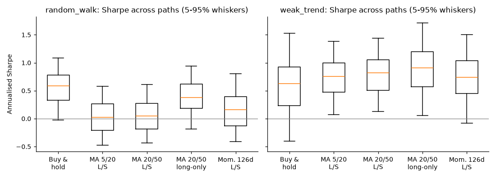
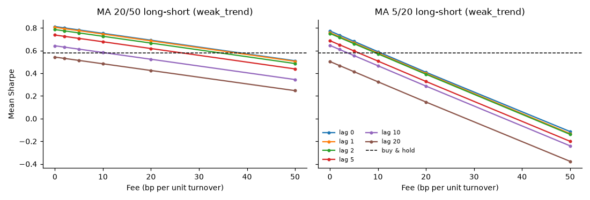
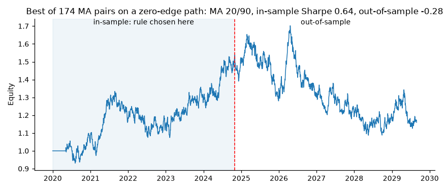
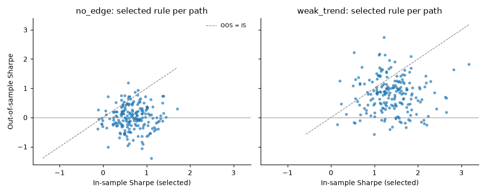

# Synthetic experiment results

Generated by `qbrp experiment all` (qbrp 0.2.0, numpy 2.5.4, pandas 3.1.1, Python 3.14.8). Every number below comes from 200 simulated price paths of 2520 trading days (~10 years), seeds 0-199. All strategies see the same paths. Unless stated otherwise: fee 1 bp per unit turnover, execution lag 1 bar. **These are simulated markets, not evidence about real ones.**

## Regimes

- `random_walk`: Geometric random walk, ~7.5%/yr drift, ~16%/yr vol. Past prices carry no information about future returns.
- `weak_trend`: Same drift and vol, but 2% of daily return variance comes from a hidden trend with persistence 0.98 (lag-1 autocorrelation ~0.02).
- `no_edge`: Random walk with zero log drift: no rule can predict returns, so long-short rules have a true Sharpe of about zero before costs.

## 1. Strategy comparison

### `random_walk`

| strategy | mean Sharpe | Sharpe p5 | Sharpe p95 | mean CAGR | mean max DD | turnover/yr | Sharpe>0 | beats B&H |
|---|---:|---:|---:|---:|---:|---:|---:|---:|
| Buy and hold | 0.56 | -0.02 | 1.09 | 8.1% | -32% | 0.1 | 94% | - |
| MA 5/20 long-short | 0.04 | -0.48 | 0.58 | -0.5% | -46% | 31.6 | 52% | 12% |
| MA 20/50 long-short | 0.07 | -0.44 | 0.61 | -0.1% | -45% | 11.1 | 60% | 10% |
| MA 20/50 long-only | 0.40 | -0.19 | 0.94 | 4.3% | -27% | 5.5 | 85% | 20% |
| Momentum 126d long-short | 0.15 | -0.41 | 0.80 | 1.3% | -43% | 17.7 | 64% | 14% |

### `weak_trend`

| strategy | mean Sharpe | Sharpe p5 | Sharpe p95 | mean CAGR | mean max DD | turnover/yr | Sharpe>0 | beats B&H |
|---|---:|---:|---:|---:|---:|---:|---:|---:|
| Buy and hold | 0.58 | -0.40 | 1.53 | 8.7% | -46% | 0.1 | 82% | - |
| MA 5/20 long-short | 0.74 | 0.07 | 1.38 | 11.2% | -33% | 28.2 | 97% | 57% |
| MA 20/50 long-short | 0.80 | 0.13 | 1.44 | 12.2% | -34% | 9.3 | 97% | 60% |
| MA 20/50 long-only | 0.89 | 0.06 | 1.72 | 10.8% | -25% | 4.6 | 96% | 86% |
| Momentum 126d long-short | 0.74 | -0.09 | 1.50 | 11.1% | -35% | 12.3 | 92% | 55% |

"beats B&H" is the share of paths on which the strategy's Sharpe exceeded buy-and-hold's Sharpe on the *same* path. The p5-p95 band shows how much a single 10-year backtest can vary by luck alone.

## 2. Fee and execution-lag sensitivity (`weak_trend`)

### MA 20/50 long-short - mean Sharpe (turnover ~9x/yr)

| fee (bp) | lag 0 | lag 1 | lag 2 | lag 5 | lag 10 | lag 20 |
|---|---:|---:|---:|---:|---:|---:|
| 0 | 0.81 | 0.81 | 0.79 | 0.74 | 0.64 | 0.54 |
| 2 | 0.80 | 0.79 | 0.77 | 0.73 | 0.63 | 0.53 |
| 5 | 0.78 | 0.78 | 0.76 | 0.71 | 0.61 | 0.51 |
| 10 | 0.75 | 0.75 | 0.73 | 0.68 | 0.58 | 0.48 |
| 20 | 0.69 | 0.69 | 0.67 | 0.62 | 0.52 | 0.42 |
| 50 | 0.51 | 0.51 | 0.49 | 0.44 | 0.34 | 0.25 |

### MA 5/20 long-short - mean Sharpe (turnover ~28x/yr)

| fee (bp) | lag 0 | lag 1 | lag 2 | lag 5 | lag 10 | lag 20 |
|---|---:|---:|---:|---:|---:|---:|
| 0 | 0.77 | 0.76 | 0.75 | 0.69 | 0.65 | 0.50 |
| 2 | 0.74 | 0.72 | 0.72 | 0.65 | 0.61 | 0.47 |
| 5 | 0.68 | 0.67 | 0.66 | 0.60 | 0.56 | 0.41 |
| 10 | 0.59 | 0.58 | 0.57 | 0.51 | 0.47 | 0.32 |
| 20 | 0.41 | 0.40 | 0.39 | 0.33 | 0.29 | 0.15 |
| 50 | -0.11 | -0.13 | -0.14 | -0.20 | -0.24 | -0.38 |

Buy-and-hold mean Sharpe on the same paths: 0.58.

## 3. Why a naive backtest misleads: choosing the best of a grid

For each path, 174 long-short moving-average pairs (fast 5-50, slow 20-200) are scored on the first half (1260 days) and the best is then evaluated on the second half.

| regime | best in-sample Sharpe | same rule out-of-sample | median rule out-of-sample | haircut | in-sample Sharpe>1 | OOS Sharpe>0 | independent-trials bound |
|---|---:|---:|---:|---:|---:|---:|---:|
| no_edge | 0.67 | 0.01 | -0.02 | 0.67 | 18% | 50% | 1.22 |
| weak_trend | 1.39 | 0.79 | 0.77 | 0.60 | 83% | 88% | 1.22 |

### One path in detail (`no_edge`, seed 46)

This path was chosen mechanically, not cherry-picked: its best in-sample Sharpe is the median across all paths. Top five pairs by in-sample Sharpe:

| rank | fast | slow | in-sample Sharpe | OOS Sharpe |
|---:|---:|---:|---:|---:|
| 1 | 20 | 90 | 0.64 | -0.28 |
| 2 | 20 | 40 | 0.51 | -0.21 |
| 3 | 20 | 30 | 0.48 | -0.36 |
| 4 | 30 | 40 | 0.42 | 0.11 |
| 5 | 20 | 80 | 0.39 | -0.05 |

See `docs/analysis.md` for interpretation.
